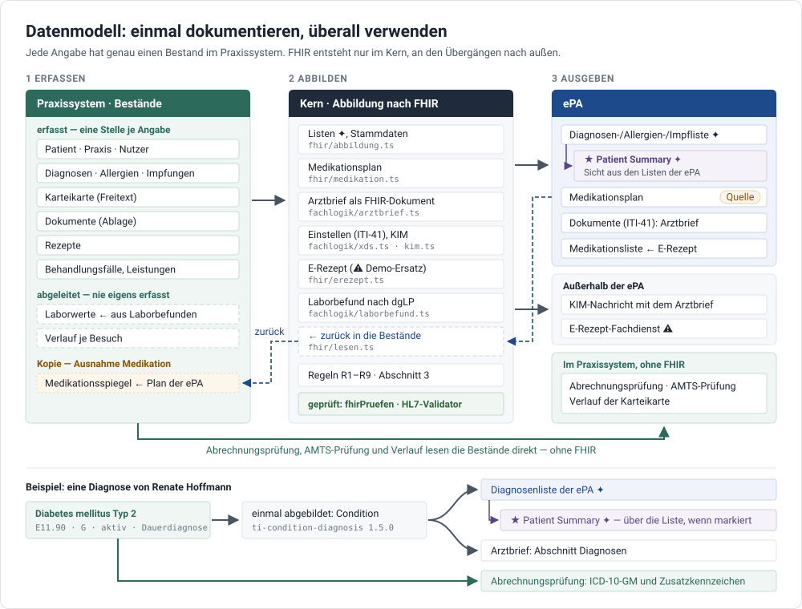

# Datenmodell — einmal dokumentieren, überall verwenden

Wie das Praxissystem Daten hält und wie daraus FHIR entsteht: für die ePA, den Arztbrief, das
E-Rezept und die Abrechnung. Entscheidung: [ADR 0039](entscheidungen/0039-einmal-dokumentieren.md).

Kennzeichnung: ⚠ = unbelegt, zu verifizieren · ▸ = Bewertung · ✦ = Vorschlag, nicht spezifiziert.

_Überblick:_ Grau durchgezogen der Weg über den Kern — dort entsteht FHIR und geht nach außen; blau
gestrichelt der Rückweg in die Bestände; grün der Weg ohne FHIR. Die Abbildung ist eine Datei
([`abbildungen/datenmodell.svg`](abbildungen/datenmodell.svg)) — wer Bestände oder Abbildungen
ändert, zieht sie nach.

## 1 Grundsatz

**Jede Angabe wird an genau einer Stelle erfasst** — in dem Bestand, zu dem sie gehört. Alles
andere ist eine **Ausgabe**: der Eintrag in einer Liste der ePA, der Arztbrief, das E-Rezept, die
Abrechnungsprüfung, der Verlauf der Karteikarte.

**FHIR ist Austauschformat, nicht Datenhaltung.** Die Bestände sind fachliche Typen
(`packages/kern/src/typen`). Wo FHIR Codes vorgibt, führen sie die Werte über eine feste Tabelle
auf diese Codes, etwa `KLINISCHER_STATUS_CODE`. Ressourcen entstehen erst an den Übergängen — und
nur im Kern:

| Übergang                                         | Abbildung im Kern                                                   |
| ------------------------------------------------ | ------------------------------------------------------------------- |
| ePA: Diagnosen-, Allergien-, Impfliste ✦         | `fhir/abbildung.ts`                                                 |
| ePA: Medikationsplan (`$add-emp-entry`)          | `fhir/medikation.ts`                                                |
| ePA: Kopfzeile `X-Requesting-Organization`       | `praxisNachFhir` in `fhir/abbildung.ts`                             |
| Arztbrief als FHIR-Dokument                      | `fachlogik/arztbrief.ts` — nutzt `abbildung.ts` und `medikation.ts` |
| ePA: Dokument einstellen (ITI-41); KIM-Nachricht | `fachlogik/xds.ts`, `fachlogik/kim.ts`                              |
| E-Rezept-Fachdienst (⚠ Demo-Ersatz)              | `fhir/erezept.ts` — nutzt `abbildung.ts`                            |
| Laborbefund nach dgLP (Beispielbefunde)          | `fachlogik/laborbefund.ts`                                          |

Die Oberfläche baut keine Ressourcen. Zurück in die Bestände führt `fhir/lesen.ts`.

## 2 Bestände und wofür sie verwendet werden

| Bestand                      | Art                                | Verbindung zur ePA                       | Verwendet in                                                                                                     |
| ---------------------------- | ---------------------------------- | ---------------------------------------- | ---------------------------------------------------------------------------------------------------------------- |
| Patient                      | erfasst (eGK)                      | KVNR = Kennung der Akte                  | jede Ausgabe: `Patient`, `subject.identifier`, XDS-Patientenkennung, E-Rezept, Betreff der KIM-Nachricht         |
| Praxisstammdaten             | erfasst, einmal je Praxis          | Telematik-ID                             | `X-Requesting-Organization`, XDS-Autor, Absender des Arztbriefs, Organisation im E-Rezept, KIM-Absender, Kontakt |
| Nutzer                       | erfasst                            | —                                        | Verfasser mit LANR (Brief, E-Rezept), Herkunft jedes Eintrags                                                    |
| Diagnosen                    | erfasst                            | `epaId`, `epaFassung` ↔ Diagnosenliste ✦ | Diagnosenliste, Arztbrief, Abrechnungsprüfung, Karteikarte, Patient Summary (über die Liste)                     |
| Allergien                    | erfasst                            | `epaId`, `epaFassung` ↔ Allergienliste ✦ | Allergienliste, Arztbrief, AMTS-Prüfung, Patient Summary                                                         |
| Impfungen                    | erfasst                            | `epaId` ↔ Impfliste ✦                    | Impfliste, Arztbrief, Patient Summary                                                                            |
| Karteikarte                  | erfasst, nur Freitext (A, B, T, S) | —                                        | Verlauf, Arztbrief (Anamnese, Befunde)                                                                           |
| Dokumente                    | Ablage                             | `epaId` (Kennung in der Akte)            | Abgleich mit der ePA, Laborwerte, Arztbrief, Einstellen über ITI-41                                              |
| Laborwerte                   | **abgeleitet** aus Laborbefunden   | —                                        | Labor, AMTS, Arztbrief                                                                                           |
| Rezepte                      | erfasst                            | `empId`, `rezeptId`                      | E-Rezept → Medikationsliste der ePA, Verknüpfung mit dem Plan                                                    |
| Medikationsspiegel           | datierte **Kopie** des Plans       | `planId`                                 | Anzeige ohne Verbindung; Arztbrief, wenn die ePA nicht antwortet                                                 |
| Behandlungsfälle, Leistungen | erfasst                            | — (Abrechnung geht nicht in die ePA)     | Abrechnungsprüfung                                                                                               |
| Verlauf je Besuch            | **abgeleitet**                     | —                                        | Karteikarte                                                                                                      |

Strukturierte Sachverhalte stehen nie als Karteitext, Laborwerte nie als eigener Bestand — sie
entstehen aus den Befunden (ADR 0016). Ein unterschriebener Brief liegt als FHIR-Dokument in der
Ablage: eine Momentaufnahme, keine zweite Quelle.

▸ **Bewertung.** Für Diagnosen, Allergien, Impfungen, Notizen, Labor und Stammdaten ist der
Grundsatz erfüllt: Eine Diagnose wird einmal erfasst und erscheint in der Liste der ePA, im Brief,
in der Abrechnungsprüfung und in der Patient Summary. **Die Medikation ist die Ausnahme**
(Abschnitt 7).

## 3 Vom Eintrag zur Ressource — die Regeln

| #   | Regel                                                           | Umsetzung                                                                                                                                                                                                                                                                                                                 |
| --- | --------------------------------------------------------------- | ------------------------------------------------------------------------------------------------------------------------------------------------------------------------------------------------------------------------------------------------------------------------------------------------------------------------- |
| R1  | **Pflicht im Profil ist Pflicht im Typ oder in der Erfassung**  | Die KVNR ist Pflichtparameter jeder Abbildung: `patient` 1..1 bei Allergie und Impfung; `subject.identifier` ist in `ti-condition-diagnosis` 1.5.0 Must Support und in der `EMPReasonCondition` des Ballots 1.4.0 Pflicht. Die Allergiemaske speichert keine Reaktion ohne Manifestation (`reaction.manifestation` 1..\*) |
| R2  | **Pflicht, aber unbekannt: `data-absent-reason`**               | Impfdosis (`protocolApplied.doseNumber[x]` 1..1) und Einnahmebeginn (`effective[x]` 1..1 in EPS) mit `unknown`, statt sie wegzulassen — `wertFehlt()`                                                                                                                                                                     |
| R3  | **Must Support: befüllen, wenn bekannt**                        | Alpha-ID, Seitenlokalisation, SNOMED CT neben ICD-10-GM, Schweregrad                                                                                                                                                                                                                                                      |
| R4  | **Optional und leer: weglassen**                                | keine leeren Listen, Objekte oder Zeichenketten (ele-1)                                                                                                                                                                                                                                                                   |
| R5  | **Kodierung: System und Code, Version wo verlangt, Text immer** | ICD-10-GM und Alpha-ID mit Version; SNOMED CT mit Version der deutschen Edition; ATC mit Version; PZN; dazu `text` — die Bezeichnung, die die Ärztin gewählt hat. An HL7-Codes steht die Anzeige der Terminologie (`Active`, `Confirmed` …); deutsche Bezeichnungen nur in der Oberfläche                                 |
| R6  | **Invarianten in Erfassung und Abbildung**                      | „irrtümlich" (`entered-in-error`) ohne klinischen Status (con-5, ait-2), ebenso Zusatzkennzeichen „A" (icd-4 der Basisprofile) und ohne Ende (con-4). Ein Ende nur bei inaktivem, behobenem oder remittiertem Status (con-4)                                                                                              |
| R7  | **Zeitpunkte intern ohne Zone, in FHIR mit Zone**               | `fhir/zeit.ts`: +01:00 oder +02:00 nach deutscher gesetzlicher Zeit, unabhängig vom Rechner                                                                                                                                                                                                                               |
| R8  | **Verweise lösen sich im Bundle auf**                           | Dokumente mit `urn:uuid:`, andere Bundles mit absoluter `fullUrl` (`fhir/vollurl.ts`)                                                                                                                                                                                                                                     |
| R9  | **Eine Abbildung je Inhalt, das Profil je Ziel**                | `patientNachFhir(p, profil)`, `praxisNachFhir(p, profil)`, `personNachFhir(…, profil)` für ePA, Brief und E-Rezept                                                                                                                                                                                                        |

## 4 Abbildungen im Einzelnen

Spalte „Kard.": Basis R4 → Profil. Pflicht = min 1; MS = Must Support.

### 4.1 Diagnose → `Condition` nach `ti-condition-diagnosis`

Paket `de.gematik.ti` 1.5.0-ballot.2, abgeleitet von `condition-eu-core`. Pflichtangaben gegen den
Snapshot 1.5.0 geprüft (15.10.2026). Gegenüber 1.4.0 ist `subject.identifier` nur noch Must Support;
neu ist der Slice `orphanet`.

| Feld im PVS                                      | FHIR-Element                                       | Kard.                   | Kodierung, Bindung                                                                                                               | Wenn leer                                                                                          |
| ------------------------------------------------ | -------------------------------------------------- | ----------------------- | -------------------------------------------------------------------------------------------------------------------------------- | -------------------------------------------------------------------------------------------------- |
| KVNR der Person                                  | `subject.identifier`                               | 0..1 → MS (1.4.0: 1..1) | `http://fhir.de/sid/gkv/kvid-10`                                                                                                 | kommt nicht vor (R1)                                                                               |
| `code`, `bezeichnung`                            | `code.coding:ICD-10-GM` (system, version, code)    | 0..1 → **1..1**, MS     | `http://fhir.de/CodeSystem/bfarm/icd-10-gm`, Version `2026`                                                                      | Pflicht in der Erfassung                                                                           |
| `zusatzkennzeichen`                              | Extension Diagnosesicherheit an der ICD-Kodierung  | MS                      | `KBV_CS_SFHIR_ICD_DIAGNOSESICHERHEIT` (required); `icd-4` bis `icd-7` koppeln es an klinischen und Verifikationsstatus (Warnung) | immer gesetzt (G, V, Z, A)                                                                         |
| `seitenlokalisation`                             | Extension Seitenlokalisation                       | MS                      | `KBV_CS_SFHIR_ICD_SEITENLOKALISATION` (required)                                                                                 | weglassen                                                                                          |
| `alphaId`                                        | `code.coding:alphaId`                              | MS, version 1..1        | `http://fhir.de/CodeSystem/bfarm/alpha-id`, Version `2026`                                                                       | weglassen                                                                                          |
| `snomed`                                         | `code.coding:snomed`                               | MS, **version 1..1**    | SNOMED CT, deutsche Edition                                                                                                      | weglassen                                                                                          |
| `bezeichnung`                                    | `code.text`                                        | MS                      | —                                                                                                                                | immer                                                                                              |
| `klinischerStatus`                               | `clinicalStatus`                                   | 0..1, MS; con-3 bis -5  | `condition-clinical` (required)                                                                                                  | bei „irrtümlich" und Zusatzkennzeichen „A" weglassen (R6)                                          |
| `diagnosesicherheit`                             | `verificationStatus`                               | 0..1, MS                | `condition-ver-status` (required)                                                                                                | immer gesetzt                                                                                      |
| `art` (Dauer, akut)                              | `category`                                         | 0..\*                   | `problem-list-item`, `encounter-diagnosis`                                                                                       | immer gesetzt                                                                                      |
| `beginn`                                         | `onsetDateTime`                                    | 0..1                    | —                                                                                                                                | Pflicht in der Erfassung                                                                           |
| `ende`                                           | `abatementDateTime`                                | 0..1; con-4             | nur bei inaktiv, behoben, Remission                                                                                              | Die Maske sperrt das Ende, solange die Diagnose gegenwärtig ist; bei „irrtümlich" entfällt es (R6) |
| `dokumentiertAm`; `festgestelltAm`               | `recordedDate`; Extension `condition-assertedDate` | 0..1                    | —                                                                                                                                | Feststellungsdatum weglassen                                                                       |
| `herkunft.verantwortlich`; `feststellendePerson` | `recorder.display`; `asserter.display`             | 0..1                    | —                                                                                                                                | feststellende Person weglassen                                                                     |
| `schweregrad`, `koerperstelle`, `notiz`          | `severity`, `bodySite.text`, `note.text`           | 0..1, 0..\*             | Schweregrad SNOMED CT                                                                                                            | weglassen                                                                                          |
| `herkunft.dokumentId`                            | Extension `source-document` ✦                      | —                       | Namensraum der Demo                                                                                                              | weglassen                                                                                          |

⚠ Nicht abgebildet ist das **Mehrfachkodierungs-Kennzeichen** (†, \*, !): Im Profil ist es Must
Support, im Diagnosemodell fehlt das Feld (Abschnitt 7).

### 4.2 Allergie → `AllergyIntolerance` nach `allergyIntolerance-eu-core` 2.0.0

| Feld im PVS                                               | FHIR-Element                                        | Kard.                 | Kodierung, Bindung                             | Wenn leer                                                            |
| --------------------------------------------------------- | --------------------------------------------------- | --------------------- | ---------------------------------------------- | -------------------------------------------------------------------- |
| KVNR                                                      | `patient` (Verweis mit Kennung)                     | **1..1**              | `kvid-10`                                      | kommt nicht vor (R1)                                                 |
| `substanz`, `snomed`                                      | `code` (`coding` SNOMED CT, `text`)                 | 0..1 → **1..1**       | SNOMED CT mit Version; Freitext nur als `text` | `text` immer                                                         |
| `klinischerStatus`                                        | `clinicalStatus`                                    | 0..1; ait-1, ait-2    | `allergyintolerance-clinical` (required)       | bei „irrtümlich" weglassen (R6)                                      |
| `gewissheit`                                              | `verificationStatus`                                | 0..1                  | `allergyintolerance-verification` (required)   | immer gesetzt                                                        |
| `typ`, `kritikalitaet`; `kategorien`                      | `type`, `criticality`; `category`                   | 0..1; 0..\*           | required                                       | `category` ohne Eintrag weglassen (R4)                               |
| `reaktionen[].manifestationen`                            | `reaction.manifestation`                            | **1..\*** je Reaktion | SNOMED CT                                      | keine Reaktion ohne Manifestation (R1)                               |
| `reaktionen[]`, übrige Angaben                            | `reaction.severity`, `onset`, `exposureRoute`       | 0..1                  | required bzw. SNOMED CT                        | weglassen                                                            |
| `beginn`                                                  | `onsetDateTime`                                     | 0..1                  | —                                              | weglassen                                                            |
| `ende`                                                    | Extension `allergyintolerance-abatement`            | 0..1                  | HL7 FHIR Extensions Pack                       | weglassen; die Maske sperrt das Ende, solange die Allergie aktiv ist |
| `herkunft.verantwortlich`; `feststellendePerson`; `notiz` | `recorder.display`; `asserter.display`; `note.text` | 0..1, 0..\*           | —                                              | weglassen                                                            |
| „keine bekannte Allergie"                                 | `code` = SNOMED CT 716186003                        | —                     | —                                              | eigene Abbildung `keineBekannteAllergieNachFhir`                     |

`onset[x]` ist der Beginn. Ein `onsetPeriod` beschreibt den Zeitraum, in dem die Allergie begann —
sein Ende ist nicht das Ende der Allergie. AllergyIntolerance hat in R4 kein `abatement[x]`; dafür
steht die Extension.

### 4.3 Impfung → `Immunization` nach `immunization-eu-core` 2.0.0

| Feld im PVS          | FHIR-Element                            | Kard.                         | Kodierung                       | Wenn leer                               |
| -------------------- | --------------------------------------- | ----------------------------- | ------------------------------- | --------------------------------------- |
| `status`             | `status`                                | **1..1**                      | `completed`, `entered-in-error` | immer                                   |
| `impfstoff`          | `vaccineCode`                           | **1..1**                      | ATC mit Version, PZN; `text`    | ATC und `text` immer                    |
| KVNR                 | `patient`                               | **1..1**                      | `kvid-10`                       | kommt nicht vor (R1)                    |
| `datum`              | `occurrenceDateTime`                    | **1..1**                      | —                               | Pflicht in der Erfassung                |
| `dosis`              | `protocolApplied.doseNumberPositiveInt` | **1..1** je `protocolApplied` | —                               | **`data-absent-reason` `unknown`** (R2) |
| `zielkrankheiten`    | `protocolApplied.targetDisease`         | 0..\*                         | SNOMED CT                       | weglassen (R4)                          |
| `geimpftVon`         | `performer.actor.display`               | 0..\*                         | —                               | immer gesetzt                           |
| `herkunft.zeitpunkt` | `recorded` (Datum)                      | 0..1                          | —                               | immer gesetzt                           |
| `charge`, `notiz`    | `lotNumber`, `note.text`                | 0..1, 0..\*                   | —                               | weglassen                               |

### 4.4 Patient, Praxis, Person

| Quelle              | Ressource      | Pflicht                                            | Profil je Ziel                                                                             |
| ------------------- | -------------- | -------------------------------------------------- | ------------------------------------------------------------------------------------------ |
| Patient             | `Patient`      | `name` 1..\*, `birthDate` 1..1 (EU Core), eu-pat-1 | `ti-patient` (Listen, Brief) · `KBV_PR_FOR_Patient` (E-Rezept)                             |
| Praxisstammdaten    | `Organization` | Name oder Kennung (org-1)                          | `ti-organization` (Kopfzeile) · ohne Profil (Brief) · `KBV_PR_FOR_Organization` (E-Rezept) |
| Nutzer (Name, LANR) | `Practitioner` | —                                                  | ohne Profil (Brief) · `KBV_PR_FOR_Practitioner` (E-Rezept)                                 |

Kennungen: KVNR `http://fhir.de/sid/gkv/kvid-10`, Telematik-ID
`https://gematik.de/fhir/sid/telematik-id`, BSNR `https://fhir.kbv.de/NamingSystem/KBV_NS_Base_BSNR`,
LANR `https://fhir.kbv.de/NamingSystem/KBV_NS_Base_ANR`.

### 4.5 Medikation

| Ausgabe                              | Ressource                                       | Pflicht                                                        | Hinweis                                                                                                                                              |
| ------------------------------------ | ----------------------------------------------- | -------------------------------------------------------------- | ---------------------------------------------------------------------------------------------------------------------------------------------------- |
| neuer Planeintrag (`$add-emp-entry`) | `MedicationRequest` nach `EMPMedicationRequest` | `status`, `intent`, `subject`                                  | `medication[x]` (R4 1..1) fehlt mit Absicht: Das Arzneimittel geht als eigener Parameter, den Verweis setzt der Dienst (IG Medication Service 1.3.5) |
| Arzneimittel des Planeintrags        | `Medication` nach `EMPMedication`               | —                                                              | ATC mit Version — ohne Version weist der Dienst ab (SPEZIFIKATION 5.3); PZN; `text`                                                                  |
| Mittel im Brief und in Dokumenten    | `MedicationStatement`                           | `status`, `medication[x]`, `subject`; EPS: `effective[x]` 1..1 | Einnahmebeginn unbekannt → `data-absent-reason` (R2)                                                                                                 |
| Verordnung                           | KBV-Verordnungsdatensatz                        | ⚠ vereinfacht (`fhir/erezept.ts`)                              | Patient, Praxis, Ärztin aus denselben Abbildungen wie oben                                                                                           |

### 4.6 Arztbrief als Dokument

`Bundle` vom Typ `document`: Kennung mit System und Wert (bdl-9), Zeitstempel (bdl-10), die
Composition als erster Eintrag (bdl-11). Was die Composition referenziert — Patient, Verfasser,
Praxis, Begegnung, Empfänger ✦, Einträge der Abschnitte —, liegt im Bundle, und alles im Bundle ist
von ihr aus erreichbar (FHIR R4, Documents). Abschnitte stehen nur mit Inhalt da, jeder mit
Erzähltext (cmp-1). Der Abschnitt Allergien steht immer — ohne Eintrag mit `emptyReason` (cmp-2
erlaubt ihn nur ohne Einträge). Einzelheiten: [SPEZIFIKATION 7.8](SPEZIFIKATION.md#78--arztbrief-adr-0038).

## 5 Abrechnung — dieselben Diagnosen

Die Abrechnung ist kein FHIR. Sie liest dieselben Diagnoseeinträge wie ePA-Liste und Brief:

- **Abrechnungsprüfung der Demo:** Der Chronikerzuschlag setzt eine gesicherte (Zusatzkennzeichen
  G), gegenwärtige Dauerdiagnose voraus — Zusatzkennzeichen, klinischer Status und Art aus dem
  Diagnosebestand.
- **Abrechnungsdatei:** Diagnosen gehen mit ICD-10-GM-Code, Zusatzkennzeichen für die
  Diagnosensicherheit und, wo sie zutrifft, Seitenlokalisation in die Abrechnung — dieselben
  Angaben, die in FHIR an der ICD-Kodierung stehen. ⚠ Die Demo erzeugt keine Abrechnungsdatei; die
  Satzbeschreibung ist nicht geprüft.

## 6 Prüfung gegen die FHIR-Spezifikation

**Was geprüft wird.** `fhirPruefen` (`kern/src/fhir/pruefung.ts`) prüft bei jedem Testlauf:

- die Pflichtelemente der Basis R4 je Ressourcentyp und der verwendeten Profile;
- die Invarianten con-3, con-4, con-5, ait-1, ait-2, org-1, eu-pat-1, cmp-1, cmp-2, bdl-7, bdl-9,
  bdl-10, bdl-11 und ele-1 — con-4 nach dem Ausdruck der Spezifikation, also auch für ein Ende ohne
  klinischen Status;
- die Dokumentregeln;
- Zeitzonen an `dateTime` und `instant`;
- die Versionen an ICD-10-GM, Alpha-ID und SNOMED CT — Fehler in den TI-Profilen, sonst Warnung.

**Wo.**

- `kern/src/fhir/pruefung.test.ts`: jede Abbildung, mit jeder Kombination aus Diagnosesicherheit
  und klinischem Status bzw. Gewissheit und Allergiestatus, jeweils mit Ende.
- `epa-sim/src/fhir-konformitaet.test.ts`: jede HTTP-Antwort des Simulators und jedes strukturierte
  Dokument beider Akten.

Ergebnis: **keine Fehler, keine Warnungen.**

**Was die Prüfung fand und was behoben ist.**

| Befund                                                                                                | Regel                                      | Behoben                                                                                         |
| ----------------------------------------------------------------------------------------------------- | ------------------------------------------ | ----------------------------------------------------------------------------------------------- |
| Diagnose ohne KVNR, wenn der Aufrufer sie nicht mitgab                                                | `subject.identifier` (1..1 im Stand 1.4.0) | KVNR ist Pflichtparameter (R1)                                                                  |
| Irrtümliche Diagnose und Allergie mit klinischem Status                                               | con-5, ait-2                               | Status entfällt (R6)                                                                            |
| Diagnose mit Ende bei gegenwärtigem Status (Wiederauftreten, Rezidiv) oder bei „irrtümlich"           | con-4                                      | Die Maske sperrt das Ende; Abbildung, Berichtigen in der Liste und Simulator lassen es weg (R6) |
| Ende einer Allergie als Ende des Beginnzeitraums (`onsetPeriod.end`)                                  | Bedeutung von `onset[x]`                   | Extension `allergyintolerance-abatement`, nur bei nicht mehr aktiver Allergie                   |
| Impfung ohne Dosis: `protocolApplied` ohne `doseNumber[x]`; ohne Zielkrankheit eine leere Liste       | Pflicht R4, ele-1                          | `data-absent-reason` (R2); Liste entfällt (R4)                                                  |
| Allergie ohne Kategorie: leere Liste                                                                  | ele-1                                      | entfällt (R4)                                                                                   |
| „Keine bekannte Allergie" ohne `patient`                                                              | `patient` 1..1                             | Abbildung im Kern mit KVNR                                                                      |
| Zeitpunkte mit Uhrzeit ohne Zone — in Brief, Laborbefund, E-Rezept und allen Antworten des Simulators | FHIR-Datentypen                            | `fhir/zeit.ts` an den Übergängen (R7)                                                           |
| Abschnittscodes des E-Rezepts ohne Codesystem                                                         | Kodierung                                  | System ergänzt (⚠ nicht gegen das KBV-Paket geprüft)                                            |
| Kontrollbefund der Kardiologie ohne Dokumentkennung                                                   | bdl-9                                      | Kennung ergänzt                                                                                 |
| SNOMED CT ohne Version in den Briefen des Simulators                                                  | Kodierung (Warnung)                        | Version ergänzt                                                                                 |

**Was die Prüfung nicht abdeckt (⚠).**

- Ob ein Code im gebundenen ValueSet liegt — dafür braucht es einen Terminologieserver.
- Slicing und Feinheiten der Profile über die Pflichtangaben hinaus.
- Die KBV-Profile des E-Rezepts in Gänze.
- Das Profil `ti-organization` im Einzelnen.
- Die Obligations der EPS je Akteur.

Die verbindliche Prüfung leistet der HL7 FHIR Validator gegen die veröffentlichten Pakete:
`npm run fhir:validieren` legt ihm alle Ausgaben vor, die `fhirPruefen` in den Tests ohne Fehler
prüft; in der CI läuft dasselbe im Job „FHIR-Validator“. **Stand 15.10.2026: keine Fehler.** Der
erste Lauf fand 965; was er fand und welche Ausnahmen mit welchem Grund gelten, steht in
ENTWICKLUNG, Abschnitt „FHIR-Validator“. Seit der Angleichung an `de.gematik.epa.laboratory`
1.0.0-ballot.1 ist auch der Laborbefund geprüft; offen sind dort nur zwei Meldungen, die keine
Instanz beheben kann (SPEZIFIKATION 5.5). Seit 16.10.2026 prüft ein Vorschau-Lauf die Ausgaben
der Vorschau auf ePA 3.2 gegen die Ballot-Pakete — die erzeugte ePS und ihre DocumentReference nach
MHD 1.2.0 (ADR 0042): keine Fehler.

Was der Validator ohne Terminologieserver nicht leistet, prüfen Tests: den Abschnitt des
Laborbefunds nach `section:result` und die Auflösung jedes Verweises im Befund
(`fachlogik/laborbefund.test.ts`).

## 7 Offene Punkte der Architektur

1. ▸ **Medikation ohne lokalen Primärbestand.**
   - Heute gilt: Der Plan in der ePA ist die Quelle. Das Praxissystem hält einen datierten Spiegel
     und die Rezepte.
   - Folge: Für eine Person ohne Akte (Frau Weber) kann die Praxis keine Dauermedikation führen.
     Ohne Verbindung kennt der Brief nur den letzten Spiegel und keinen Einnahmebeginn.
   - ✦ Vorschlag: lokale Medikationseinträge als Primärbestand mit `epaId` zum Planeintrag —
     dasselbe Muster wie bei Diagnosen, Allergien und Impfungen.
2. **Mehrfachkodierungs-Kennzeichen** (†, \*, !) fehlt im Diagnosemodell, obwohl Must Support.
3. **Namen von Personen** stehen beim Verfasser als `name.text`. ⚠ Die KBV-Profile verlangen
   strukturierte Namen.
4. **Abrechnungsdatei.** Die Angaben liegen vor (Abschnitt 5), eine Ausgabe fehlt.
5. **Diagnosesicherheit und klinischer Status.** Die Deutschen Basisprofile koppeln beide über
   `icd-4` bis `icd-7` (Warnung): G → aktiv/bestätigt, V → aktiv/vorläufig oder Differential,
   Z → behoben/bestätigt, A → ohne Status/widerlegt. Die Abbildung setzt „A“ ohne Status um. ⚠ Offen:
   Wird eine Diagnose behoben, müsste das Kennzeichen auf „Z“ wechseln; die Maske tut das nicht. Der
   Startbestand zeigt den Fall (Harnwegsinfektion, „G“ und behoben — Warnung `icd-5`).
6. **Ballot 1.4.0.** Was eine Übernahme an Abbildungen und Wegen ändert — Grund im Plan als
   `reasonReference`, Common Query API, Patient Service mit `$summary` —, steht in
   [SPEZIFIKATION 5.12](SPEZIFIKATION.md#512-abgleich-mit-den-ballots-140-15102026).
7. **Herkunft je Eintrag in der Patient Summary.** Das ✦ Dokument trägt die Änderungseinträge
   aller Fassungen, damit die Herkunftszeile „angelegt von“ zeigen kann. Im Dokument liegt aber nur
   die aktuelle Fassung; die Provenance früherer Fassungen ist dort nicht auflösbar (HL7-Validator).
   ✦ Zu klären: nur die Provenance der enthaltenen Fassung und die Herkunft am Eintrag selbst.
8. **Laborbefund nach dgLP.** Angeglichen an den Ballot `de.gematik.epa.laboratory`
   1.0.0-ballot.1 (15.10.2026): Hierarchie Gruppe → Einzelwert, Einsender als Organisation,
   Pflichtangaben an Probe, Auftrag und Composition (SPEZIFIKATION 5.5). Offen bleiben Punkte im
   Ballot selbst:
   - ▸ `dr-comp-identifier` ist mit den dgLP-Profilen nicht erfüllbar (Ausnahme im Validator).
   - ▸ `obs-range-2` schließt einseitige Referenzbereiche aus; die Demo setzt die fehlende Grenze
     mit `data-absent-reason` — ⚠ ob das dgLP das so vorsieht, ist offen.
   - Die gematik-Codesysteme `laboratory-identificator` und `laboratory-study-group` stehen in
     Version 1.1.0 in `de.gematik.terminology` 1.1.0-ballot.2. Das Laborpaket führt es bewusst
     nicht als Abhängigkeit; der Validator lädt es eigens (SPEZIFIKATION 5.5, Befund 4).
   - Die Laborbefunde tragen keinen Laborbereich an der Gruppe und keine optionalen Angaben
     (Akkreditierung, kritisches Ergebnis, alternative Ergebnisse).
